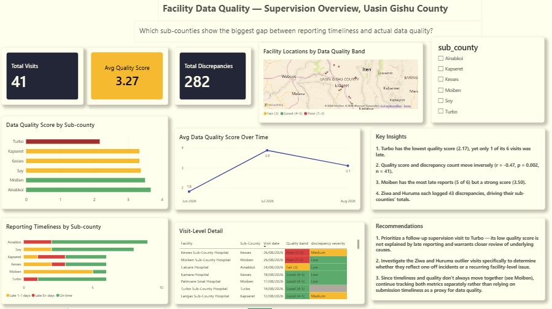

# Facility Data Quality & Indicator Monitoring


An M&E-style analytics pipeline that pairs **field supervision data** (KoboToolbox) with **routine health-system reporting** (DHIS2), cleaned and validated in Python, modelled in PostgreSQL, and presented in a two-page Power BI dashboard.

> **Data note:** The supervision submissions in this project are **simulated for portfolio purposes**. Sub-county names are real places in Uasin Gishu County, Kenya, used for realism, but **no figure here describes the actual performance of any real facility**. GPS coordinates are approximations. The DHIS2 data comes from DHIS2's public demo instance.

## Project question

Does reporting on time mean the data is good? A facility can submit its monthly report promptly and still have poor-quality records. This project builds the supervision layer that would catch that difference, and shows it next to a routine DHIS2 indicator.

## Dashboard

| Page 1: Supervision overview | Page 2: Routine indicator trend |
|---|---|
|  |  |

A PDF export is in `dashboard/`.

## Pipeline

| Stage | Tool | What it does |
|---|---|---|
| 1. Collect | KoboToolbox (XLSForm) | Facility data quality checklist: cascading sub-county → facility select, skip logic, range validation, hints, GPS |
| 2. Clean | Python (pandas) | Rename and trim the Kobo export, encode structural missingness, resolve GPS inconsistencies, range checks |
| 3. Engineer features | Python (pandas) | `reporting_status`, `quality_band`, `discrepancy_severity`, `num_discrepancy_types`, `visit_month` |
| 4. Validate | Python (scipy) | Correlation, descriptive sub-county comparison, IQR outlier check, missingness validation |
| 5. Model | PostgreSQL (SQLAlchemy) | `facility_visits` table plus two views: `vw_subcounty_summary`, `vw_facility_latest_visit` |
| 6. Integrate | Python (REST API) | Pull ANC 1st visit from the DHIS2 analytics API into `dhis2_anc1_indicator` |
| 7. Present | Power BI (DirectQuery) | Two-page dashboard with semantic red/amber/green coloring |

## Data sources

- **KoboToolbox form:** 6 sub-counties (Kesses, Turbo, Kapseret, Moiben, Ainabkoi, Soy), 14 facilities, 41 submissions.
- **DHIS2 demo instance:** ANC 1st visit at one organisation unit, monthly, September 2025 to August 2026 (11 months with data).

## Key data decisions

- **Structural missingness:** `delay_reason` and `days_late` are blank by design when a report was on time. They are encoded as "N/A - submitted on time" and `0`, not imputed.
- **GPS inconsistency:** two facilities had more than one coordinate pair across visits. Each was resolved to the most frequently reported pair.
- **Genuine gap kept:** one late submission had no recorded reason. It is left blank and reported, not filled in.
- **No interpolation:** DHIS2 returned no value for November 2025, so the gap is left as a gap and the average uses the 11 months with data.
- **Raw data untouched:** the original Kobo export is never edited. Cleaning runs in code and can be re-run on a fresh export.
- **KoboToolbox and DHIS2 are not merged.** The demo instance uses a different organisational hierarchy from Uasin Gishu, so a row-level join would require inventing a match. They are shown as parallel panels. Against a real facility hierarchy, the same pipeline would support a direct join.

## Findings (on the simulated data)

- Quality score and discrepancy count move inversely: **r = -0.47, p = 0.002, n = 41**. This is directional, not a powered inferential result.
- **Turbo** has the lowest average quality score (2.17) despite only 1 of 6 visits being late. **Moiben** has the most late reports (5 of 6) but a comparatively strong score (3.50). Timeliness and quality do not move together.
- Two individual visits recorded 43 discrepancies each, against an IQR upper bound of 18.5, and drive their sub-counties' totals.
- ANC 1st visits averaged **1,548 per month**, peaking at **2,122 in May 2026** (about 37% above average).

## Repository structure

Adjust to match your repo.

```
├── data/
│   ├── raw/                  # original Kobo export (unmodified)
│   └── processed/            # cleaned and feature-engineered CSVs
├── notebooks/
│   ├── stage1_ingest_and_clean.ipynb
│   ├── stage2_feature_engineering.ipynb
│   └── stage3_statistical_validation.ipynb
├── src/
│   ├── config.py
│   ├── stage4_postgres.py
│   ├── stage5_dhis2.py
│   └── stage6_parallel_load.py
├── forms/
│   └── facility_data_quality_checklist_uasingishu.xlsx
├── dashboard/
│   ├── facility_dq_dashboard.pbix
│   ├── facility_dq_dashboard.pdf
│   └── facility_dq_theme.json
├── images/
├── .env.example
├── .gitignore
└── README.md
```

## How to run

1. Install Python packages: `pandas numpy scipy sqlalchemy psycopg2-binary requests python-dotenv openpyxl jupyter`
2. Create a PostgreSQL database named `facility_dq_db`.
3. Copy `.env.example` to `.env` and fill in your values. `.env` is git-ignored.
4. Put your Kobo export in `data/raw/` and set its filename in `config.py`.
5. Run the notebooks and scripts in stage order.
6. Open the `.pbix` in Power BI Desktop and point it at your local database.

`.env.example`:

```
DB_HOST=127.0.0.1
DB_PORT=5432
DB_NAME=facility_dq_db
DB_USER=postgres
DB_PASSWORD=your_password_here

DHIS2_BASE_URL=https://play.im.dhis2.org/stable-2-43-1/api
DHIS2_USERNAME=admin
DHIS2_PASSWORD=district
```

The DHIS2 credentials are the public demo logins. The demo URL changes as new versions are released, so check the current one if requests fail.

## Limitations

- n = 41 is a demonstration sample. Results are descriptive, not a statistically powered study.
- The supervision data is simulated, and facility GPS coordinates are approximations.
- The `.pbix` uses DirectQuery against a local PostgreSQL database, so it cannot be refreshed without that database. Use the PDF and screenshots to see the finished report.

## Skills demonstrated

Form design (XLSForm, cascading selects, validation) · data cleaning and documented decisions · feature engineering · statistical validation with honest scope · SQL views · REST API integration · DirectQuery dashboards with semantic color design · credential management with environment variables

## Author

Jentrix · [github.com/jentrix-semo](https://github.com/jentrix-semo)
